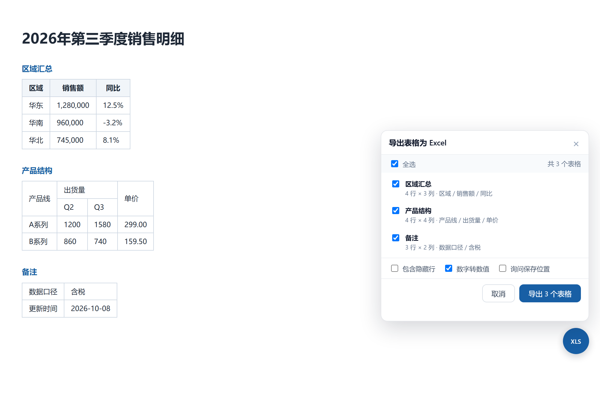
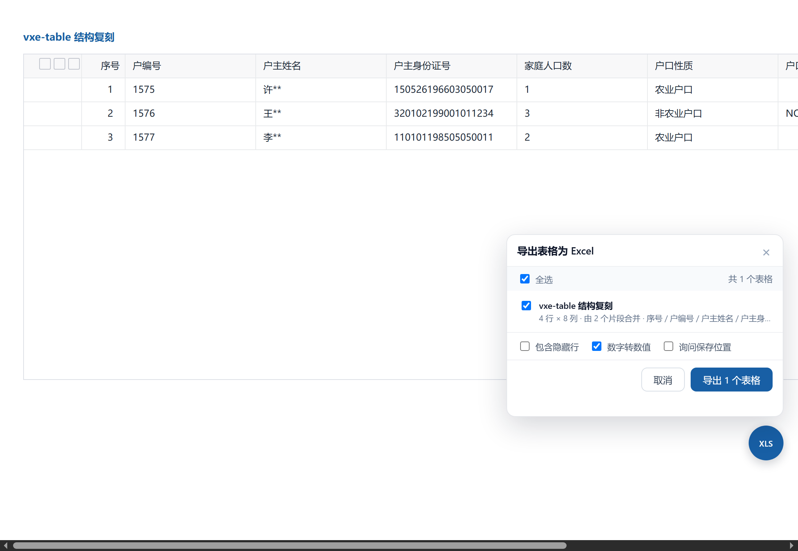

<div align="center">


# 网页表格导出 Excel

**一键把网页里的表格导出成真正的 `.xlsx` 文件**

纯本地运行 · 零第三方依赖 · 不联网 · 不上传任何数据

[](manifest.json)
[](https://www.google.com/chrome/)
[](https://www.microsoft.com/edge)
[](#浏览器兼容性)

[](LICENSE)

[功能](#功能特性) · [安装](#安装) · [使用](#使用) · [核心难点](#核心难点组件化表格的片段合并) · [能力边界](#能力边界) · [开发](#开发与测试) · [FAQ](#常见问题)

</div>

---

## 这是什么

一个浏览器扩展。打开任意含表格的网页，点右下角的 **XLS** 按钮，勾选需要的表格，就能下载一个 Excel 文件——**每个表格一个 Sheet，合并单元格、数字类型、列宽都给你还原好**。

和市面上同类插件的区别在于三件事：

1. **不拆表**。vxe-table、el-table、ant-design 这类组件库会把表头、表体、固定列渲染成多个 `<table>`，多数工具会把它导出成 3~4 个 Sheet。这个扩展按几何与语义把它们重新拼成一张表。
2. **不用 SheetJS**。xlsx 写入器是自己实现的（zip + OOXML），整个扩展 500 KB 以内，没有体积和许可证负担，也没有任何远程请求。
3. **不偷偷删列**。空列、空行、空白单元格原样保留，唯一会删的是纯勾选框列。

> 一个本地运行的浏览器扩展：把网页里的 `<table>` 导出成 `.xlsx`。不联网、不上传数据、不依赖任何 CDN 或第三方库。
>
> A dependency-free browser extension that exports HTML tables to real `.xlsx` files. Everything runs locally — no network requests, no data leaves your machine.



## 功能特性

| 能力 | 说明 |
|---|---|
| **多表多 Sheet** | 整页所有表格一次导出，每张表独立 Sheet，Sheet 名取 `caption` / `aria-label` / 上方小标题，重名自动加序号 |
| **合并单元格还原** | `rowspan` / `colspan` 先展开成网格，再在 xlsx 里写回真实的合并区域，不是简单补空 |
| **多级表头** | 原样保留为多行表头，不做猜测性合并 |
| **数字类型识别** | `1200`、`-5.5`、`3.14` 写成数值可直接求和；`0012`、`1,234`、`12%`、超 15 位长数字保持文本，不会被 Excel 改坏 |
| **隐藏行过滤** | 默认跳过 `display:none` 的行，可勾选一并导出 |
| **iframe 支持** | 同源 iframe 内的表格一并汇总，面板上带 `iframe` 标记 |
| **Shadow DOM 穿透** | Web Components 里的表格也能找到（`querySelectorAll` 默认穿透不了 shadow root） |
| **布局表格过滤** | 老系统「table 套 table」的页面布局，判定为布局表并跳过外层 |
| **片段自动合并** | 表头/表体/固定列被拆成多个 `<table>` 时合并为一张表，详见[下文](#核心难点组件化表格的片段合并) |
| **序号列还原** | CSS `counter` 生成的序号（DOM 里为空）按 `counter-reset` / `counter-increment` 还原 |
| **勾选列剔除** | 表头是勾选框且整列为空的列自动去掉，其余空列一律保留 |
| **自动列宽** | 按内容估算（中文按 2 个字符宽），长文本列给足宽度 |
| **文本清洗** | `<br>` 与块级元素转成单元格内换行，`&nbsp;` 转空格，首尾空白与多余空行去掉 |

## 安装

扩展是「已解压」形式，**文件夹必须固定放在一个位置**，移动或删除会导致扩展失效。建议放到 `C:\Tools\table-to-xlsx`。

### Chrome

1. 地址栏输入 `chrome://extensions`
2. 右上角打开「开发者模式」
3. 点「加载已解压的扩展程序」，选择本文件夹（含 `manifest.json` 的那一层）
4. 如需导出本地 `file://` 打开的网页，进入扩展详情页，打开「允许访问文件网址」

### Edge

1. 地址栏输入 `edge://extensions`
2. 左下角打开「开发人员模式」
3. 点「加载解压缩的扩展」，选择本文件夹

### 360 极速浏览器

1. 地址栏输入 `chrome://extensions`（部分版本为 `se://extensions`）
2. 打开「开发者模式」
3. 点「加载已解压的扩展程序」，选择本文件夹

> 装完请**刷新已打开的标签页**，悬浮按钮才会注入。
>
> Chrome 137 之后官方已收紧命令行/离线安装 crx 的入口，「加载已解压」是最稳妥的方式。

## 使用

打开任意含表格的网页，右下角会出现蓝色 **XLS** 按钮（页面有表格时才会出现）。

1. 点按钮 → 弹出面板，自动列出本页所有可导出的表格（含 iframe 内的）
2. 勾选需要的表格（默认全选）
3. 点「导出 N 个表格」→ 浏览器下载一个 xlsx，每个表格一个 Sheet

也可以用工具栏图标打开面板，或直接「导出本页全部表格」。

### 导出选项

| 选项 | 默认 | 说明 |
|---|---|---|
| 包含隐藏行 | 关 | 关闭时不导出 `display:none` 的行 |
| 数字转数值 | 开 | 纯数字写成数值类型；`0012`、`1,234`、`12%`、超 15 位长数字仍保持文本 |
| 询问保存位置 | 关 | 开启后弹出系统保存对话框 |

## 核心难点：组件化表格的片段合并

这是本项目最有价值的部分，也是同类工具最容易出错的地方。

**问题**：vxe-table / el-table / ant-design Table 在开启固定列或虚拟滚动时，会把一张视觉上的表格拆成多个 `<table>`：

```html
<div class="vxe-table--main-wrapper">
  <table class="vxe-table--header">  <!-- 表头是独立的 table -->
  <table class="vxe-table--body">    <!-- 表体是另一个独立的 table -->
  <!-- 有固定列时，还会再复制一份列出来 -->
</div>
```

它们在 DOM 里互不相干。如果按「一个 `<table>` = 一张表」来扫描，结果就是表头、表体、序号列各占一个 Sheet。

**解法**：判据不依赖框架名（框架会换，结构不变量不会），只认三条几何与语义特征：

| 判据 | 内容 | 作用 |
|---|---|---|
| ① 列边界重合 | 取每个 `td/th` 的 `getBoundingClientRect()`，左右边界四舍五入后比较，容差 3px，重合度 > 90% | 证明「它们画在同一组列上」 |
| ② 垂直邻接 + 水平齐平 | 表头底边 ≈ 表体顶边（差 < 4px），左右边界一致 | 区分「同一张表的上下两半」与「并排的两个独立表格」 |
| ③ 角色互补 | 纯表头（只有 `th`）+ 纯表体（只有数据行）才合并；两个都是完整表格的**永不合并** | 最后的安全阀 |

再加上**固定列去重**（固定列的边界是主表子集 → 按边界映射叠掉）、**多实例隔离**（按最近公共容器分组，页面有几个表格组件就聚合几个 Sheet）和 **sanity check**（合并后列数、行数对不上就放弃合并，退回独立导出）。

**宁可分开，也不乱合**——分数不够就不合并。面板上会直接标出识别依据，例如 `表头 + 24 行 · 由 2 个片段合并`，合错了你能一眼看出是哪条判据出的问题。



## 能力边界

诚实说明哪些能做、哪些做不到：

| 情况 | 结果 |
|---|---|
| 表头/表体拆成两个 table（vxe、el-table 固定列） | ✅ 自动合并为一张表 |
| 固定列复制整份列 | ✅ 按列边界映射去重 |
| 多实例表格 | ✅ 各自聚合成各自 Sheet，按 DOM 顺序排列 |
| Shadow DOM 里的表格（Web Components） | ✅ 递归穿透 |
| 老式布局表格（table 套 table） | ✅ 判定为布局表，跳过外层 |
| `div` / CSS Grid 拼出来的「假表格」 | ❌ 不导出（DOM 里没有行列语义，识别准确率不可控，未实现） |
| 虚拟滚动 / 分页加载的表格 | ⚠️ 只能导出当前 DOM 里已渲染的行 |
| Canvas 绘制的表格 | ❌ 无法导出（DOM 里没有单元格） |
| 跨域 iframe | ❌ 受同源策略限制，取不到 |
| 超大表格（数万行） | ⚠️ 可以导出，但内存占用随行数线性增长 |

## 浏览器兼容性

| 浏览器 | 内核 | 状态 |
|---|---|---|
| Chrome | Chromium ≥ 102 | ✅ 主测试环境 |
| Edge | Chromium ≥ 102 | ✅ 同一份包直接可用 |
| 360 极速浏览器 | Chromium 132.0.6805.0 | ✅ 实测可用（MV3 完全支持，无需兼容包） |

内核低于 88 的老版本 360 不支持 MV3，需要另外维护一份 MV2 包，本项目未提供。

## 技术实现

```
网页 DOM
  │  parser.js     扫描 → 分组 → 片段合并 → 网格展开（rowspan/colspan）
  ▼
二维数组 + 合并区域 + 列宽
  │  xlsx.js       自己实现的 zip + OOXML 写入器
  ▼
.xlsx (Blob) → background.js 汇总各 frame → chrome.downloads 下载
```

几个刻意的工程选择：

- **不用 SheetJS**：xlsx 本质是 zip 里装几个 XML，自己写一遍约 400 行，换来零依赖、无许可证约束、体积可控。
- **CSSOM 逐条设置面板样式**：企业内网页面常有严格 CSP（`style-src 'self'`），`<style>` 标签会被拦，逐条 `el.style.x = ...` 不受影响。代价是没有 hover 动效。
- **Shadow DOM 挂载 UI**：面板挂在 `attachShadow({mode:'open'})` 里，页面样式再野也污染不到它。
- **下载降级**：走 `chrome.downloads`，失败时自动退回 `<a download>`。

## 目录结构

```
table-to-xlsx/
├─ manifest.json          # MV3 声明（permissions / content_scripts / action）
├─ background.js          # 跨 frame 汇总、取数路由、下载
├─ content/
│  ├─ parser.js           # 扫描、片段合并、rowspan/colspan 展开、文本清洗
│  ├─ xlsx.js             # 极简 xlsx 写入器（zip + OOXML，零依赖）
│  └─ content.js          # 悬浮按钮、选择面板、导出编排
├─ popup/                 # 工具栏弹窗（HTML + CSS + JS）
├─ icons/                 # 16 / 32 / 48 / 128 图标
├─ docs/                  # README 截图
├─ test/                  # 测试页面与自动化脚本
└─ build.py               # 打包脚本（生成 zip）
```

## 开发与测试

需要 **Node 22+**（用到内置 `WebSocket`）和本机 Chrome。

```bash
# 解析 + 生成逻辑单测（15 项断言）
node test/run-tests.mjs

# 组件化表格片段合并回归（11 项断言，vxe-table 结构复刻样本）
node test/eval.mjs test/vxe.html "JSON.parse(document.getElementById('out').textContent)"

# 端到端：真实加载扩展 → 点按钮 → 导出 → 校验下载文件（15 项断言）
node test/e2e.mjs

# 打包
python build.py
```

**测试页面**

| 文件 | 覆盖场景 |
|---|---|
| `test/run.html` | 各类边界表格：合并单元格、多级表头、隐藏行、嵌套表、`<br>` 换行、大表 |
| `test/vxe.html` | 表头/表体拆分、勾选列、CSS counter 序号列（按真实 vxe-table 结构复刻） |
| `test/page.html` | 真实业务样式页面 |
| `test/page-frame.html` | iframe 内表格 |

当前状态：**41 项断言全部通过**，300 行 × 8 列大表解析耗时约 50 ms。

> 注意：Chrome 137 起已禁用 `--load-extension`，自动化测试改用 CDP 的 `Extensions.loadUnpacked`（需要 `--enable-unsafe-extension-debugging` 启动参数）。

## 常见问题

<details>
<summary><b>装完没看到右下角的 XLS 按钮？</b></summary>

刷新一下已打开的标签页。扩展是 `document_idle` 时注入的，安装前已打开的页面不会被注入。
</details>

<details>
<summary><b>面板里同一个表出现了好几条？</b></summary>

说明片段合并的分数没到阈值。请把面板截图和该页面的表格 HTML 片段提个 Issue，我按实际结构调整容差或判据。
</details>

<details>
<summary><b>导出的序号列是空的？</b></summary>

序号是 CSS `counter` 生成的，DOM 里为空。扩展会读 `counter-reset` / `counter-increment` 还原；如果表格用的是自定义 JS 生成的伪元素或分页导致计数断裂，可能读不到，此时留空。
</details>

<details>
<summary><b>导出的身份证号 / 订单号变成科学计数法了？</b></summary>

不会。超过 15 位的纯数字会被强制按文本写入，避免 Excel 精度丢失。如果仍然异常，请提 Issue 附上原值。
</details>

<details>
<summary><b>能导出全部数据而不是当前页吗？</b></summary>

不能。虚拟滚动和分页表格的 DOM 里只有已渲染的行，扩展读不到未渲染的数据。可以先把每页都导出，再在 Excel 里合并。
</details>

<details>
<summary><b>会上传我的数据吗？</b></summary>

不会。扩展没有任何网络请求，权限里也没有远程 host。所有解析和文件生成都在本地页面完成。
</details>

## 贡献

欢迎提 Issue 和 PR，尤其是**真实页面的表格结构样本**——这是最有价值的输入。提交解析相关 Issue 时，请附上：

1. 表格所在页面的 DOM 片段（`<table>` 外层容器到 `</table>`，脱敏后即可）
2. 面板截图（能看到被识别成了几张表）
3. 期望的导出结果（几行几列、哪些列不该出现）

新增解析规则时请同时补测试页面，确保 `run-tests.mjs` / `eval.mjs` / `e2e.mjs` 三套都能跑通。

## 许可证

[MIT](LICENSE)
